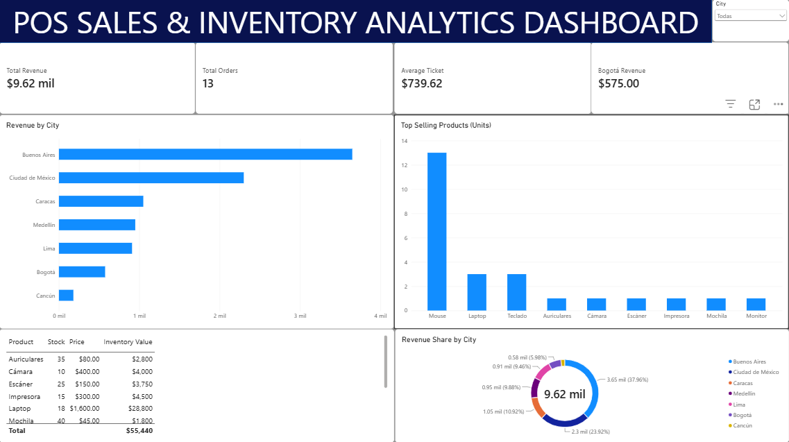

# POS Sales & Inventory Analytics Dashboard (Power BI)

## 📊 Dashboard Preview

## 🎯 Project Overview
An end-to-end Business Intelligence solution designed in **Power BI Desktop** and connected directly to a relational **SQL Server (`PROYECTO_POS`)** database. This executive dashboard transforms raw transactional sales and stock records into actionable visual insights for regional performance and inventory valuation.

## 🛠️ Key DAX Measures & Logic Implemented
* **Total Revenue:** `SUM(Ventas[total])` — Tracks overall gross sales volume across all regions.
* **Total Orders:** `COUNTROWS(Ventas)` — Monitors transactional volume.
* **Average Ticket:** `DIVIDE([Total Revenue], [Total Orders])` — Evaluates average customer spending per order safely without division-by-zero errors.
* **Bogotá Revenue:** `CALCULATE([Total Revenue], Clientes[ciudad] = "Bogotá")` — Demonstrates filter context manipulation using `CALCULATE`.
* **Inventory Value:** `SUMX(Productos, Productos[stock] * Productos[precio])` — Computes real-time capital tied up in active warehouse inventory row-by-row.

## 💡 Business Insights Highlighted
* **Regional Dominance:** Buenos Aires and Ciudad de México drive over 61% of total revenue.
* **Product Velocity:** Computer mice lead unit sales volume significantly, requiring tighter stock monitoring compared to higher-ticket items like laptops.
* **Interactive Filtering:** Includes dynamic regional slicing (`City` dropdown) allowing stakeholders to isolate specific market metrics instantly.

## 📂 Files Included
* `POS_Sales_Dashboard.pbix`: Complete Power BI source file with data model relationships and DAX measures.
* `dashboard_preview.png`: High-resolution executive view of the final report.
